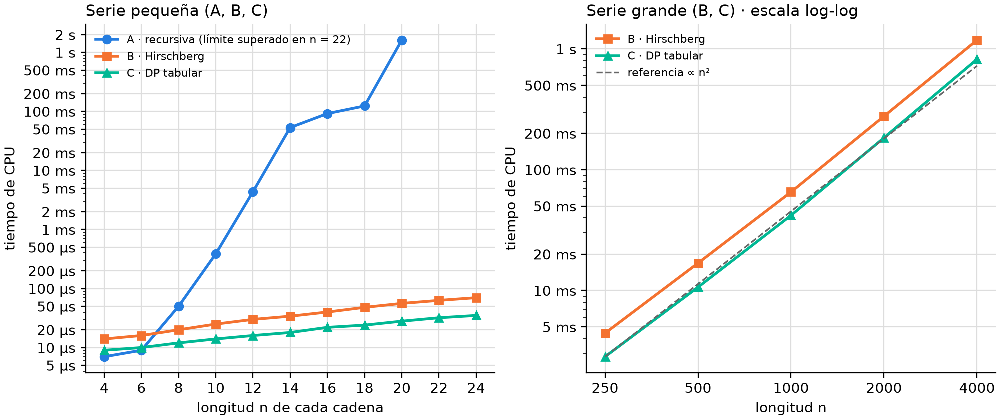
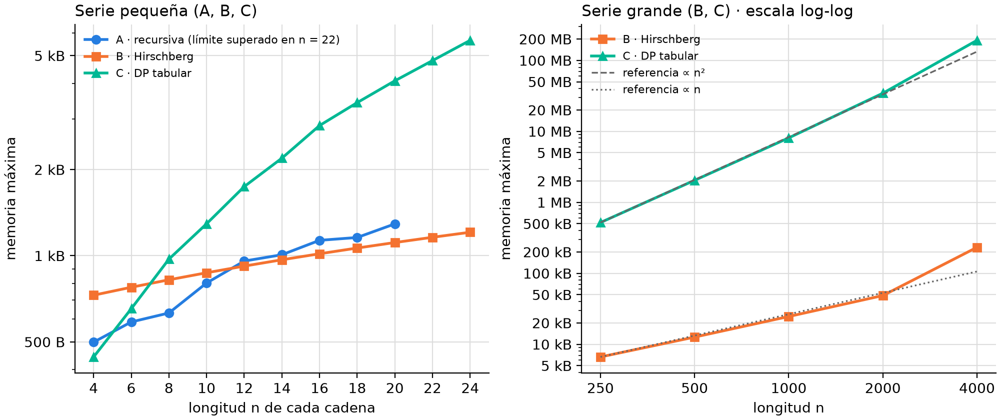
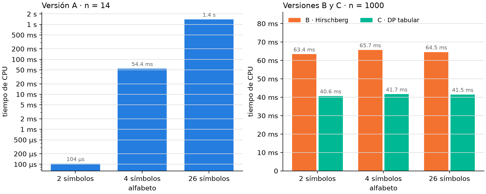

# LCS: recursiva, Hirschberg y programación dinámica

**Actividad 1 · Diseño Avanzado de Algoritmos · UNIPRO**
Autor: Miguel Sánchez Hernández

Implementación y comparación experimental de tres algoritmos para calcular la
**subsecuencia común más larga** (LCS, Longest Common Subsequence) de dos cadenas,
midiendo tiempo de CPU y memoria máxima de cada uno.

## Las tres versiones

| Versión | Módulo | Estrategia | Tiempo | Memoria |
|---|---|---|---|---|
| A | `recursive.py` | Recursión directa, sin memorización | O(2^(m+n)) | O(m+n) (pila) |
| B | `hirschberg.py` | Divide y vencerás de Hirschberg (1975) | Θ(m·n), aprox. 2·m·n | Θ(m+n) |
| C | `dp.py` | Programación dinámica tabular | Θ(m·n) | Θ(m·n) |

Las tres devuelven una LCS como cadena. No se usa ninguna librería externa de LCS:
la única dependencia del programa es `matplotlib`, para las gráficas.

## Requisitos

- **[uv](https://docs.astral.sh/uv/)**: gestiona Python y las dependencias. Si no
  tienes Python 3.15, `uv` lo descarga automáticamente en la primera ejecución.
  - macOS / Linux: `curl -LsSf https://astral.sh/uv/install.sh | sh` (o `brew install uv`)
  - Windows (PowerShell): `powershell -ExecutionPolicy ByPass -c "irm https://astral.sh/uv/install.ps1 | iex"`
- **make** (opcional): viene incluido en macOS (herramientas de línea de comandos de
  Xcode) y en Linux. En Windows, usa los comandos `uv` equivalentes de la tabla.

## Ejecución (comando único)

```bash
git clone https://github.com/kensei-io/lcs-hirschberg-dp.git
cd lcs-hirschberg-dp
make
```

`make` instala el entorno, ejecuta los tests y lanza los experimentos completos
(unos 2 minutos en un MacBook Pro M5). Los resultados se guardan en `results/`.

| Comando | Equivalente sin `make` | Qué hace |
|---|---|---|
| `make` | `uv run pytest` y `uv run lcs-hirschberg-dp` | Tests y experimentos completos |
| `make test` | `uv run pytest` | Solo los tests (42) |
| `make experiments` | `uv run lcs-hirschberg-dp` | Solo los experimentos completos |
| `make quick` | `uv run lcs-hirschberg-dp --quick` | Versión reducida (segundos), en `results/quick/` |
| `make plots` | `uv run lcs-hirschberg-dp --plots-only` | Rehace las gráficas desde el CSV, sin medir |
| `make lint` | `uv run ruff check .` y `uv run ruff format --check .` | Revisión de estilo del código |

Opciones adicionales: `uv run lcs-hirschberg-dp --help`
(por ejemplo, `--repeats 10` o `--seed 1`).

## Uso desde Python

```python
from lcs_hirschberg_dp.dp import lcs_dp
from lcs_hirschberg_dp.hirschberg import lcs_hirschberg
from lcs_hirschberg_dp.recursive import lcs_recursive

lcs_dp("ABCBDAB", "BDCABA")          # 'BCBA'
lcs_hirschberg("ABCBDAB", "BDCABA")  # 'BDAB' (otra LCS, también de longitud 4)
lcs_recursive("ABCBDAB", "BDCABA")   # 'BCBA' (solo para cadenas cortas)
```

Puede haber varias LCS de la misma longitud. A y C usan el mismo criterio de
desempate y devuelven la misma; B puede devolver otra igual de larga.

## Estructura del repositorio

```
lcs-hirschberg-dp/
├── src/lcs_hirschberg_dp/
│   ├── __init__.py          Marca la carpeta como paquete de Python
│   ├── recursive.py         Versión A: recursiva directa
│   ├── hirschberg.py        Versión B: divide y vencerás de Hirschberg
│   ├── dp.py                Versión C: programación dinámica tabular
│   ├── generator.py         Parejas de cadenas aleatorias reproducibles
│   ├── measure.py           Tiempo de CPU y memoria máxima, en procesos aislados
│   ├── experiments.py       Series de experimentos y CSV (comando lcs-hirschberg-dp)
│   └── plots.py             Gráficas a partir del CSV
├── tests/
│   ├── test_lcs.py          Corrección de las tres versiones
│   └── test_experiments.py  Generador, medición y flujo completo
├── results/
│   ├── measurements.csv     Mediciones de los experimentos completos
│   ├── time.png             Tiempo de CPU
│   ├── memory.png           Memoria máxima
│   └── alphabet.png         Influencia del tamaño del alfabeto
├── .gitignore               Archivos que Git no sube (.venv, cachés, results/quick/…)
├── .python-version          Versión de Python del proyecto (3.15)
├── Makefile                 Comandos de make (comando único de ejecución)
├── pyproject.toml           Configuración del proyecto y dependencias
├── uv.lock                  Versiones exactas de las dependencias
└── README.md                Este documento
```

Al ejecutar el proyecto se crean además `.venv/` (entorno de Python, lo crea `uv`)
y `results/quick/` (resultados de `make quick`). Ninguna de las dos se sube al
repositorio.

## Metodología experimental

- **Series:**
  - *pequeña*: n = 4…24, versiones A, B y C, con un límite de 20 s por ejecución
    para A;
  - *grande*: n = 250, 500, 1000, 2000 y 4000, versiones B y C;
  - *alfabeto*: alfabetos de 2, 4 y 26 símbolos con longitud fija (n = 14 para A,
    n = 1000 para B y C).
- **Cadenas:** dos cadenas aleatorias de longitud n sobre el alfabeto ACGT
  (salvo en la serie de alfabeto), generadas con semilla fija: los datos son
  reproducibles.
- **Tiempo:** tiempo de CPU (`time.process_time`), mediana de 5 repeticiones.
- **Memoria:** pico de memoria reservada por el algoritmo (`tracemalloc`), sin
  contar las cadenas de entrada. Se mide en una ejecución aparte, porque
  `tracemalloc` ralentiza el programa y falsearía los tiempos.
- **Aislamiento:** cada medición se ejecuta en un proceso nuevo de Python, para
  que una medición no afecte a la siguiente y para poder detener las que superan
  el límite de tiempo.

## Resultados





- **A** crece de forma exponencial: con n = 20 tarda ~1,6 s y con n = 22 supera el
  límite de 20 s. Su coste depende mucho del alfabeto: con n = 14 pasa de ~0,1 ms
  (2 símbolos) a ~1,4 s (26 símbolos).
- **B y C** crecen de forma cuadrática en tiempo. B es aproximadamente 1,5 veces
  más lenta que C, y ninguna de las dos depende del alfabeto.
- **En memoria**, C crece de forma cuadrática (~190 MB con n = 4000) y B de forma
  lineal (~48 kB con n = 2000): Hirschberg cambia un poco de tiempo por un ahorro
  de memoria de varios órdenes de magnitud.

Los datos exactos están en [`results/measurements.csv`](results/measurements.csv).

## Notas sobre reproducibilidad

- Los **tiempos** dependen de la máquina; las tendencias (exponencial, cuadrática)
  y las proporciones entre versiones se mantienen.
- La **memoria** es determinista para una misma entrada, pero depende de la versión
  de Python: CPython reutiliza los enteros pequeños (hasta 1024 en Python 3.15; 256
  en versiones anteriores como la 3.13), y por encima de ese valor cada entero
  ocupa un objeto propio. Esto explica el salto de memoria de B en n = 4000, que no
  altera su complejidad Θ(n).
- Para comprobar que todo funciona sin esperar a los experimentos completos:
  `make quick`.